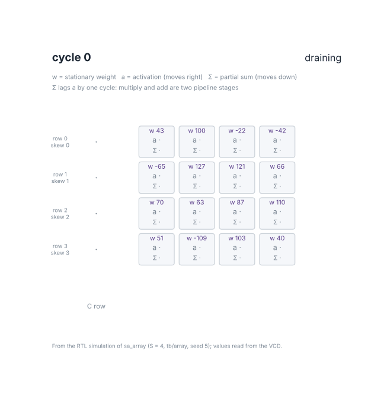
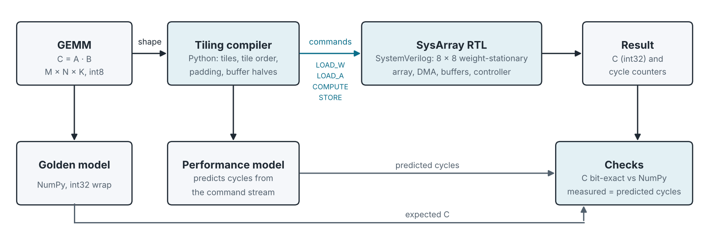
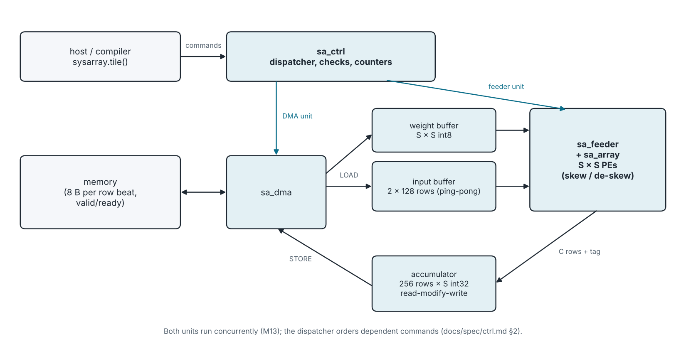

# SysArray: an int8 systolic-array GEMM accelerator and its compiler

[](https://github.com/Fe3w/systolic-array-gemm-accelerator/actions/workflows/ci.yml)


[](LICENSE)

**A matrix-multiply accelerator built from scratch: an 8 × 8 weight-stationary
systolic array in SystemVerilog (the dataflow of the TPU v1 matrix unit), plus
a Python compiler that maps any GEMM onto it. Overlapping data movement with
compute raised PE utilization on BERT and ResNet-50 layers from 0.43–0.45 to
0.78–0.82, and a performance model predicted every measured cycle count
exactly (16 / 16 runs).**

<p align="center">
  
</p>
<p align="center"><sub>One 4 × 4 tile from the RTL simulation, one frame per clock cycle:
weights load on top, rows of A enter skewed, partial sums Σ move down, a row of C
leaves at the bottom. <a href="docs/waveforms/README.md">How to read it and see the waveforms</a>.</sub></p>

**Built with:** SystemVerilog · cocotb + Verilator · Python + NumPy ·
Yosys + nextpnr (Lattice ECP5 FPGA) · LibreLane / OpenROAD (SkyWater SKY130) ·
GitHub Actions

## At a glance (8 × 8 array)

| | Result | Source |
| --- | --- | --- |
| **Performance** | PE utilization **0.78–0.82** on BERT, ResNet-50 3×3 and 256³ GEMMs; **1.77–1.83× fewer cycles** than the first version | `results/perf/be6f466.csv` vs `results/perf/f5c0a0c.csv` |
| **Performance model** | Predicted cycle counts from the command stream alone; **measured = predicted in 16 / 16** runs | `results/perf/be6f466.csv` |
| **Compiler** | Tiles any M × N × K into array commands; the weight-reuse tile order beats the alternative (0.745 vs 0.618 on 256³) with **4× fewer weight bytes** | `results/perf/be6f466.csv` |
| **Correctness** | **1,000 / 1,000** random compiler-driven GEMMs bit-exact vs NumPy, with random memory latency and stalls | `results/verification/campaign_cd2849e.json` |
| **FPGA** | Full accelerator at **92.89 MHz** on a Lattice ECP5, one DSP per PE (64) | `results/synth/sa_top_S8_ebfc542.json` |
| **ASIC** | Array placed and routed on SKY130: **1.053 mm²** core, DRC / LVS clean; timing sign-off still open ([details](docs/PPA.md)) | `results/asic/sa_array_S8_0d8ca14_15ns_io30.json` |

Every number in this repository comes from a file in `results/` produced by a
committed script and is cited next to it. Predictions are labelled
"predicted (analytical)".

## How it works



A GEMM C = A · B goes in. The **compiler** cuts it into array-sized tiles and
emits a stream of four commands (LOAD_W, LOAD_A, COMPUTE, STORE). The
**hardware** runs the stream and returns C plus cycle counters. Two
independent models check every run: NumPy for the values, and a performance
model for the cycle count.

## The hardware



- **Weight-stationary 8 × 8 array.** Each processing element (PE) holds one
  int8 weight, multiplies it by the int8 activation passing through, and adds
  the product to an int32 partial sum flowing down. Peak: 64 MACs per cycle.
- **Skew and de-skew.** Row r of the array sees its input r cycles late, so
  every operand meets the right partial sum. A full row of C leaves 2S = 16
  cycles after its row of A enters (measured = model in 10 / 10,
  `results/latency/latency_d4aedec.csv`).
- **Double buffering.** The controller runs the DMA and the array feeder at
  the same time, and the input buffer is split into two halves, so the next
  block of A loads while the current one computes.
- **Memory side.** A DMA moves one 8-byte row per cycle over valid/ready
  handshakes into the weight, input and int32 accumulator buffers.

Per-block design, cycle tables and the dataflow diagram:
[ARCHITECTURE.md](docs/ARCHITECTURE.md). Full specs: [docs/spec/](docs/spec/).

## Performance


The first version serialized everything: load A, compute, store, repeat. On the
BERT, ResNet-50 3×3 and 256³ layers it kept the array busy only 43–45 % of
the time. Overlapping
the next LOAD_A with the current COMPUTE raised that to 78–82 %. What still
costs cycles: reloading weights (≈ 3S cycles per weight tile, no shadow weight
registers yet) and STORE, which cannot overlap COMPUTE because the accumulator
has one read port. That is why r50_1x1 (K = 64, few tiles per output) stops
at 0.600. The next step, shadow weights plus STORE overlap, is predicted
(analytical) to reach ≈ 0.88 on 256³ (D-030).

The roofline (peak 64 MACs/cycle, DMA 8 bytes/cycle, ridge at 8 MACs/byte),
all nine shapes with measured vs predicted cycles, and a cross-check
against SCALE-Sim: [PERFORMANCE.md](docs/PERFORMANCE.md).

## The compiler

`compiler/sysarray/` is a small Python compiler that targets this hardware:

- **Tiling.** Splits M × N × K into S × S weight tiles and chunks of rows of A
  (128 by default, half the input buffer), and zero-pads partial tiles so any shape runs (`tiler.py`).
- **Two loop orders.** Order A keeps a weight tile in place and streams all
  rows of A through it; order B walks chunks of A on the outside and reloads
  weights. Measured, order A wins on every shape tested (table below).
- **Scheduling for overlap.** Alternates LOAD_As between the two input-buffer
  halves, and moves each LOAD_A ahead of an independent LOAD_W or STORE so its
  transfer overlaps the previous COMPUTE.
- **Performance model.** `predict.py` replays the controller's timing from
  the command stream and predicts cycles and utilization before the RTL runs.

| Shape (chunk = 64 rows) | order A util. | order B util. | A weight bytes | B weight bytes |
| --- | --- | --- | --- | --- |
| sq256 | 0.745 | 0.618 | 65,536 | 262,144 |
| bert_proj | 0.742 | 0.654 | 589,824 | 1,179,648 |
| r50_1x1 | 0.579 | 0.497 | 212,992 | 802,816 |

Source: `results/perf/be6f466.csv` (rows with m_c = 64).

```bash
make compile M=128 N=768 K=768   # one GEMM's command stream + predicted cycles
```

## Verification

- A spec with a cycle table, then a cocotb test, then the RTL, for every
  block, shown failing first where feasible.
- NumPy golden model with the hardware's int32 wrap-around.
- Random programs covering all 16 ordered command pairs against a
  functional model of the command semantics.
- 1,000 random compiler-driven GEMMs per campaign with random memory latency
  and stalls; corner cases such as all −128, all 127 and int32 overflow.
- Seeds logged and replayable; Verilator lint at zero warnings; CI on every
  push.

Method and full coverage: [VERIFICATION.md](docs/VERIFICATION.md).

## Hardware cost

| Target | Block | Result | Source |
| --- | --- | --- | --- |
| Lattice ECP5 LFE5U-85F (Yosys + nextpnr) | full accelerator `sa_top` | 92.89 MHz; 64 MULT18X18D, 10 DP16KD, 7,301 FF, 2,728 LUT4 | `results/synth/sa_top_S8_ebfc542.json` |
| SkyWater SKY130 (LibreLane) | 8 × 8 array `sa_array` | 15 ns clock, core 1.053 mm²; DRC / LVS / antenna 0; max-slew violations remain, so not yet signed off | `results/asic/sa_array_S8_0d8ca14_15ns_io30.json` |

The Fmax history, every SKY130 run including the failed ones, and the
slew-repair analysis: [PPA.md](docs/PPA.md).

## Key design decisions

Each decision has its context, alternatives and consequences in
[DECISIONS.md](docs/DECISIONS.md). The ones that shaped the design most:

- **Weight-stationary over output-stationary** (D-001). Each weight is reused
  by every row of A, at the cost of skew/de-skew logic and an accumulator
  read-modify-write for K > S.
- **Smallest change that removes the measured bottleneck** (D-030). Double
  buffering through concurrent dispatch and a compiler buffer convention, not
  shadow weights in every PE. That kept the verified array unchanged. The
  cost is that the weight reload is still exposed.
- **Padding on the host, exact performance model** (D-025). No zero-fill
  hardware; the model is exact for a memory that never stalls. With stalls
  the hardware is slower than predicted.
- **Safety check kept, then made fast** (D-028). An error on reading
  never-written buffer rows first cut Fmax. A two-cycle CHECK and registered
  range ends brought `sa_top` to 92.89 MHz at +1 cycle per command (utilization
  −0.001 to −0.009).

## Run it yourself

Ubuntu 24.04, about 15 minutes to install and verify:
[LOCAL_SETUP.md](docs/LOCAL_SETUP.md).

| What | Command | Time |
| --- | --- | --- |
| Demo: one BERT-head GEMM on the RTL, NumPy check, measured vs predicted cycles | `make demo` | seconds |
| All tests (lint, Python, RTL) | `make check lint test` | ~6 min on 4 cores |
| Random verification campaign | `make campaign` | ~2 min |
| Benchmarks + plots | `make perf` | ~30 min |
| FPGA synthesis | `make synth` | ~5–10 min per top |
| SKY130 place-and-route (Docker) | `make asic PERIOD=15` | ~60 min |

## Limitations

- Weight reload and STORE are not hidden yet (no shadow weights; one
  accumulator read port).
- The performance model is exact only for a memory that never stalls; with a
  real DRAM it would need a bandwidth term.
- SKY130 covers the array only (no SRAM macros) and is not fully signed off:
  max-slew violations remain, and the best slew-repaired run misses setup by
  0.453 ns at the slow corner (D-033).
- The random campaign uses small shapes (up to 35) for speed; the large BERT
  and ResNet-50 shapes are checked against NumPy in every benchmark run.
- Out of scope: output-stationary variant, formal verification, bf16, an
  MLIR front end.

## Repository map

| Path | What |
| --- | --- |
| `rtl/` | SystemVerilog: `pe/`, `array/`, `mem/`, `dma/`, `core/`, `ctrl/`, `top/`, `common/` |
| `compiler/sysarray/` | tiler, command format, performance model, functional simulator, golden model, CLI |
| `tb/` | cocotb testbenches, one directory per block |
| `scripts/` | toolchain install, synthesis, ASIC flow, measurement, verification, figures |
| `results/` | measured data only, each file named after the commit that produced it |
| `docs/` | [PERFORMANCE](docs/PERFORMANCE.md) · [VERIFICATION](docs/VERIFICATION.md) · [PPA](docs/PPA.md) · [ARCHITECTURE](docs/ARCHITECTURE.md) · [DECISIONS](docs/DECISIONS.md) · [BRIEF](docs/BRIEF.md) · [CONVENTIONS](docs/CONVENTIONS.md) · [RESULTS index](docs/RESULTS.md) · [waveforms](docs/waveforms/README.md) |

## License

MIT: see [LICENSE](LICENSE).
