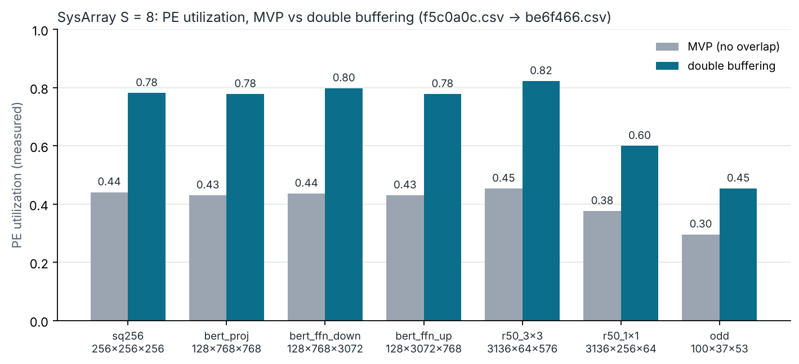
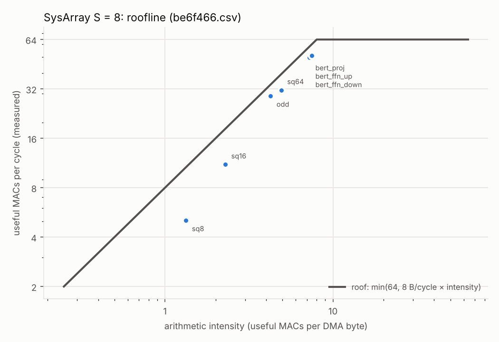

# SysArray

### An int8 systolic-array accelerator for matrix multiplication, with its own compiler

Matrix multiplication is the core of every neural network. SysArray is a small
hardware engine for it, built from scratch: an **8 × 8 grid of multiply-add
units** in SystemVerilog, in the same style as the matrix unit in Google's
TPU, plus a **Python compiler** that splits any matrix multiply into work
the hardware can run.

  

The array at work, one frame per clock cycle (4 × 4 version, straight from the RTL
simulation): weights load from the top, input rows flow in from the left, sums flow down,
results leave at the bottom.

## Highlights

| | |
| --- | --- |
| ⚡ **0.78 – 0.82 utilization** | of the 64 multiply-add units on real BERT and ResNet-50 3×3 layers, up from 0.43–0.45 in the first version |
| 🚀 **up to 1.8× faster** | than the first version on the same layers, by overlapping data movement with compute |
| 🎯 **16 / 16 exact predictions** | a performance model predicts the cycle count before the hardware runs, and matched every measurement |
| 🧠 **Own compiler** | tiles any matrix size into hardware commands; picks the loop order with 4× less weight traffic |
| ✅ **1,000 / 1,000 tests pass** | random matrix multiplies, bit-exact against NumPy |
| 🔧 **92.89 MHz on FPGA** | full accelerator on a Lattice ECP5, one DSP block per multiply-add unit |
| 🏭 **1.053 mm² on silicon** | placed and routed on the open SkyWater SKY130 process |

**Built with:** SystemVerilog · cocotb · Verilator · Python · NumPy ·
Yosys · nextpnr · LibreLane / OpenROAD · GitHub Actions

---

## Architecture

- The **compiler** turns a matrix multiply into four simple commands:
  load weights, load inputs, compute, store.
- The **controller** runs them, keeping the DMA and the array busy at the
  same time.
- Each of the **64 processing elements** holds one weight, multiplies it by
  the input passing through, and passes the running sum down to the
  **accumulator**.
- The **input buffer has two halves** (ping-pong): the next block of data
  loads while the current one is being computed.

## How data moves through the array

Each input row enters one cycle later than the row above it (the *skew*), so
every number meets the right partial sum at the right time. A finished row of
results leaves 2 × 8 = 16 cycles after its inputs enter.

The same tile as signal traces from the simulation:

## From matrix multiply to hardware

Every run is checked twice: the results against NumPy, and the cycle count
against the performance model's prediction.

The compiler supports two loop orders. Keeping each weight tile in the array
and streaming all inputs through it (order A) beats reloading weights for
every block of inputs (order B):

| Layer (64-row blocks) | Order A utilization | Order B utilization | Order B weight traffic |
| --- | --- | --- | --- |
| 256 × 256 × 256 | **0.745** | 0.618 | 4.0× of A |
| BERT projection | **0.742** | 0.654 | 2.0× of A |
| ResNet-50 1×1 | **0.579** | 0.497 | 3.8× of A |

## Performance

The first version did one thing at a time: load, compute, store. Overlapping
the next load with the current compute (double buffering) almost doubled the
useful work per cycle.

| Layer | Size (M × N × K) | Cycles | Utilization |
| --- | --- | --- | --- |
| 256³ square | 256 × 256 × 256 | 335,463 | 0.781 |
| BERT projection | 128 × 768 × 768 | 1,516,071 | 0.778 |
| BERT FFN down | 128 × 768 × 3072 | 5,912,103 | 0.798 |
| BERT FFN up | 128 × 3072 × 768 | 6,063,879 | 0.778 |
| ResNet-50 3×3 | 3136 × 64 × 576 | 2,195,807 | 0.823 |
| ResNet-50 1×1 | 3136 × 256 × 64 | 1,338,343 | 0.600 |

Measured on the RTL; the performance model predicted every one of these cycle
counts exactly.

  
  

Left: measured utilization per shape (bars) vs prediction (black lines), and the two
loop orders. Right: roofline, peak 64 multiply-adds per cycle against 8 bytes per cycle of memory bandwidth.

More detail: [Performance deep dive](docs/PERFORMANCE.md)

## Verification

- Every block got a spec and a cocotb test **before** its RTL was written.
- **NumPy** is the reference: every result is compared bit for bit.
- **1,000 random matrix multiplies** per campaign, with random memory delays
  and stalls, plus corner cases (all −128, all 127, int32 overflow).
- All **16 command pairs** tested back to back.
- Random seeds are logged so any failure can be replayed; CI runs lint and
  all tests on every push.

More detail: [Verification](docs/VERIFICATION.md) ·
[How to read the waveforms](docs/waveforms/README.md)

## Hardware cost

**FPGA** (Lattice ECP5 LFE5U-85F, Yosys + nextpnr)

| Block | Fmax | DSP | Flip-flops | LUT4 | Block RAM |
| --- | --- | --- | --- | --- | --- |
| One processing element | 191.13 MHz | 1 | 49 | 1 | 0 |
| 8 × 8 array | 112.99 MHz | 64 | 3,896 | 15 | 0 |
| Full accelerator | **92.89 MHz** | 64 | 7,301 | 2,728 | 10 |

**ASIC** (SkyWater SKY130, LibreLane): the 8 × 8 array placed and routed at a
15 ns clock in a **1.053 mm²** core, 4,832 flip-flops, DRC and LVS clean.

More detail: [FPGA and ASIC results](docs/PPA.md)

## Key design choices

- **Weight-stationary dataflow:** each weight stays in place and is reused by
  every input row, which cuts weight traffic.
- **Double buffering through the compiler:** a buffer convention and a
  smarter controller instead of new hardware in every PE, so the verified
  array stayed untouched.
- **Safety checks kept:** reading never-written memory is caught in
  hardware. It first cost clock speed; a two-cycle check brought the full
  design to 92.89 MHz for one extra cycle per command.

All decisions, with alternatives and trade-offs: [DECISIONS.md](docs/DECISIONS.md)

## Try it

Setup on Ubuntu 24.04: [docs/LOCAL_SETUP.md](docs/LOCAL_SETUP.md). Then
`make demo` runs a BERT-sized matrix multiply on the RTL and compares it with
NumPy and the predicted cycle count.

## Repository

| Folder | What's inside |
| --- | --- |
| `rtl/` | SystemVerilog hardware |
| `compiler/` | Python compiler, performance model, NumPy reference |
| `tb/` | cocotb testbenches |
| `scripts/` | synthesis, ASIC flow, measurement, figures |
| `results/` | all measured data |
| `docs/` | [architecture](docs/ARCHITECTURE.md), [performance](docs/PERFORMANCE.md), [verification](docs/VERIFICATION.md), [FPGA/ASIC](docs/PPA.md), [decisions](docs/DECISIONS.md), [original brief](docs/BRIEF.md) |

MIT License
