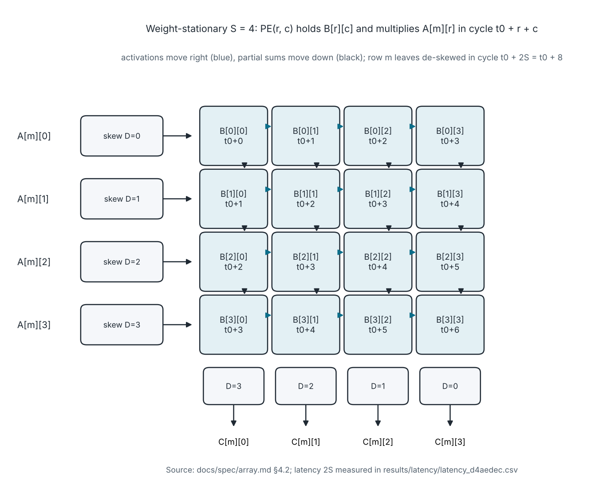
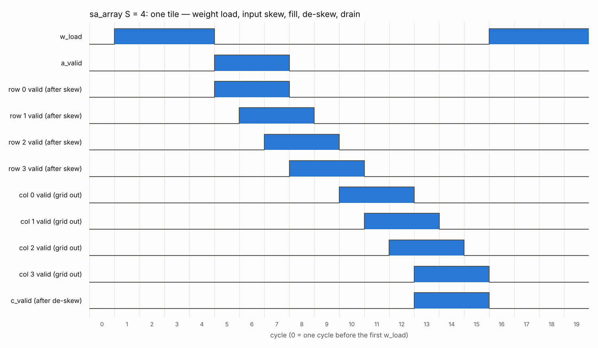
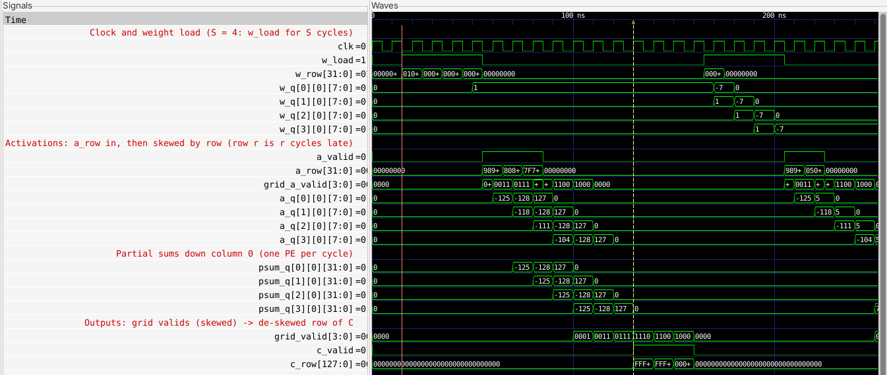

# SysArray: an int8 systolic-array GEMM accelerator in SystemVerilog

**An 8 × 8 weight-stationary systolic array for matrix multiplication, built
from scratch: bit-exact against NumPy on 1,000 / 1,000 random GEMMs, PE
utilization 0.44 → 0.78 with double buffering, a cycle-exact performance
model (16 / 16 runs), 92.89 MHz on a Lattice ECP5 FPGA, and placed and routed
on SkyWater SKY130 in a 1.053 mm² core (slew not yet fully clean).** Sources for every number:
[Headline results](#headline-results-s--8).

<p align="center">
  
</p>
<p align="center"><sub>One S = 4 tile, one frame per clock cycle, every value read from the RTL
simulation's waveform: weights shift in on top, rows of A enter with the skew,
partial sums Σ move down, a row of C leaves at the bottom.
How to read it and view the waveforms yourself: <a href="#see-it-run-waveforms">See it run</a>.</sub></p>

**Built with:** SystemVerilog (RTL) · cocotb + Verilator (verification) ·
Python + NumPy (tiling compiler, golden model, performance model) · Yosys +
nextpnr (FPGA) · LibreLane / OpenROAD (ASIC, SkyWater SKY130) · GitHub Actions
(CI).

## What it is

An S × S array of multiply-accumulate cells in synthesizable SystemVerilog,
with a DMA, buffers, an accumulator and a command controller that overlaps
data movement with compute; a Python compiler that tiles any C = A·B into
commands for it; and a performance model that predicts its cycle count
exactly. Every block was specified with a cycle table before its RTL
(`docs/BRIEF.md`, `docs/spec/`), tested first with cocotb against NumPy, then
measured: cycles and utilization on BERT and ResNet-50 layer shapes, FPGA cost
on Lattice ECP5, and area and timing on SkyWater SKY130.

> Every number on this page comes from a file in `results/` produced by a
> script in this repository, cited next to it (index: `docs/RESULTS.md`; all
> numbers: `docs/RESULTS_SUMMARY.md`, generated). Predictions are labelled
> "predicted (analytical)".

## Headline results (S = 8)

| What | Result | Source |
| --- | --- | --- |
| Correctness | **1,000 / 1,000** random compiler-driven GEMMs vs NumPy, plus corners incl. int32 wrap | `results/verification/campaign_cd2849e.json` |
| Utilization, MVP → double buffering | sq256 **0.441 → 0.781**; BERT layers 0.430–0.436 → **0.778–0.798**; ResNet-50 3×3 0.453 → **0.823** | `results/perf/f5c0a0c.csv` → `results/perf/be6f466.csv` |
| Performance model | cycle-exact: measured = predicted in **16 / 16** runs | `results/perf/be6f466.csv` |
| FPGA, ECP5 LFE5U-85F | `sa_core` **98.93 MHz**, full `sa_top` **92.89 MHz**; 64 MULT18X18D, 10 DP16KD (MVP `sa_core`: 82.4–85.2 MHz) | `results/synth/sa_core_S8_931741d.json`, `results/synth/sa_top_S8_ebfc542.json` |
| ASIC, SKY130 `sa_array` | 15 ns (66.7 MHz), core **1.053 mm²**, DRC/LVS/antenna 0 in every run; **no run is fully clean yet**: timing met with 12,787 max-slew violations (run 4), or 91 max-slew violations with setup −0.453 ns at the slow corner (run 8, after slew repair) | `results/asic/sa_array_S8_0d8ca14_15ns_io30.json` |
| Array latency | 2S = 16 cycles; tile time M + 3S, measured = model 10/10 | `results/latency/latency_d4aedec.csv` |

## Architecture


- **Dataflow:** weight-stationary. PE(r, c) holds B[k0 + r][n0 + c];
  activations move right, partial sums move down; each PE multiplies in one
  cycle and adds in the next.
- **Skew / de-skew:** row element r enters r cycles late and column c leaves
  S − 1 − c cycles late, so a whole row of C leaves 2S cycles after its row of A
  enters:



- **Double buffering:** the controller runs the DMA and the feeder
  concurrently with explicit dependency checks; the compiler alternates the
  input buffer's two halves; each accumulator row carries its own address and
  mode, so back-to-back COMPUTEs need no gap.
- **One tile at S = 4, cycle by cycle:** the animation at the top of this
  page (`make animate`, `scripts/report/animate_tile.py`), and the same tile
  as signal traces (`scripts/waves/plot_tile.py`; the GTKWave view is in
  [See it run](#see-it-run-waveforms)):



Per-block interfaces, behaviour and cycle tables: `docs/ARCHITECTURE.md`;
full contracts: `docs/spec/`.

## Performance

All rows: `results/perf/be6f466.csv` (`make perf`, S = 8, double buffering
with the two-cycle CHECK; memory always ready with read latency 3 and one
8-byte row per cycle). Every run also checks C against NumPy. The measured cycle counters
equal the predictor's replay of the controller timing in **16 / 16 runs**.
The last column is the v0.1 MVP (no overlap, `results/perf/f5c0a0c.csv`).


| Shape | M × N × K | cycles (measured) | predicted (analytical) | utilization | MVP utilization |
| --- | --- | --- | --- | --- | --- |
| sq8 | 8 × 8 × 8 | 101 | 101 | 0.079 | 0.078 |
| sq16 | 16 × 16 × 16 | 369 | 369 | 0.173 | 0.146 |
| sq256 | 256 × 256 × 256 | 335,463 | 335,463 | 0.781 | 0.441 |
| bert_proj | 128 × 768 × 768 | 1,516,071 | 1,516,071 | 0.778 | 0.430 |
| bert_ffn_down | 128 × 768 × 3072 | 5,912,103 | 5,912,103 | 0.798 | 0.436 |
| bert_ffn_up | 128 × 3072 × 768 | 6,063,879 | 6,063,879 | 0.778 | 0.430 |
| r50_3x3 | 3136 × 64 × 576 | 2,195,807 | 2,195,807 | 0.823 | 0.453 |
| r50_1x1 | 3136 × 256 × 64 | 1,338,343 | 1,338,343 | 0.600 | 0.376 |
| odd | 100 × 37 × 53 | 6,752 | 6,752 | 0.454 | 0.296 |

**What double buffering changed.** The controller now dispatches to
the DMA and the feeder concurrently (`docs/spec/ctrl.md` §2), the compiler
alternates LOAD_As between the two input-buffer halves, and the accumulator
tags each row, so the next chunk's LOAD_A runs while the current chunk
streams. A k-tile of 256 rows now costs ≈ 2 × 131 + 2S + 7 cycles instead of
≈ 2M + 40 (predicted, analytical; `docs/spec/ctrl.md` §3). What is left:
the weight reload (≈ 3S cycles per k-tile, no shadow weights, D-030), the
STORE (4 cycles per row, exclusive with COMPUTE: one accumulator read port)
and, for small shapes, fill/drain and command decode. r50_1x1 (K = 64: only 8
k-tiles per output strip) is the most STORE-bound shape (0.600).


**Tile order.** At m_c = 64, order A (weight reuse) still wins because order
B reloads every weight tile once per M chunk:

| Shape (m_c = 64) | order A util. | order B util. | A weight bytes | B weight bytes |
| --- | --- | --- | --- | --- |
| sq256 | 0.745 | 0.618 | 65,536 | 262,144 |
| bert_proj | 0.742 | 0.654 | 589,824 | 1,179,648 |
| r50_1x1 | 0.579 | 0.497 | 212,992 | 802,816 |

**SCALE-Sim v3** (same 8×8 WS array and buffer sizes; `results/scalesim/`,
note in `results/scalesim/COMPARISON.md`): for sq8 / sq16 / sq64 / odd it
reports 43 / 240 / 14,078 / 4,570 cycles vs the SysArray MVP's 103 / 438 / 12,696 /
10,355 (`results/perf/f5c0a0c.csv`). SCALE-Sim assumes prefetching (double-buffered) SRAMs, so the gap on the
small shapes is SysArray's serialized DMA and command overhead. sq256
(`results/scalesim/sq256/COMPUTE_REPORT.csv`): 2,963,801 cycles, 2,678,515 of
them stalls from the minimum-size SRAM config, vs the MVP's 594,528. The other
large shapes have no SCALE-Sim result (stated in the note).

## FPGA cost (Yosys + nextpnr-ecp5, LFE5U-85F, speed grade 6)

| Top | Fmax (MHz) | MULT18X18D | FF | LUT4 | CCU2C | DP16KD | Source |
| --- | --- | --- | --- | --- | --- | --- | --- |
| `sa_pe` | 191.13 | 1 | 49 | 1 | 16 | 0 | `results/synth/sa_pe_S0_c64045a.json` |
| `sa_array` S = 8 | 112.99 | 64 | 3,896 | 15 | 784 | 0 | `results/synth/sa_array_S8_c64045a.json` |
| `sa_core` S = 8 (double buffering) | 98.93 | 64 | 5,818 | 986 | 973 | 10 | `results/synth/sa_core_S8_931741d.json` |
| `sa_top` S = 8 (final) | 92.89 | 64 | 7,301 | 2,728 | 4,774 | 10 | `results/synth/sa_top_S8_ebfc542.json` |

Fmax of `sa_core` went from 60.55 MHz (`results/synth/sa_core_S8_0c93383.json`)
to 82.4–85.2 MHz after a timing pass (`results/synth/sa_core_S8_d4aedec*.json`,
buffer → array register, two-stage MAC) and to the numbers above after a
second one (3-stage accumulator read-modify-write; the PE's product register
mapped onto the MULT18X18D output register, D-027). Double buffering's
concurrent dispatcher first cost
`sa_top` 84.63 → 71.07 MHz (`results/synth/sa_top_S8_931741d.json`: 48-bit
gate compares in the dispatch path); small gate down-counters and a delayed
`macs_issued` update brought it back to 84.18 MHz (D-031,
`results/synth/sa_top_S8_ea8fa1b.json`). A second CHECK cycle (D-028) and the command's row-range ends registered at accept give 92.89 MHz, at a
cost of one cycle per command (utilization −0.001 to −0.009,
`results/perf/be6f466.csv` vs `931741d.csv`). Remaining limiter in `sa_core`:
the accumulator BRAM → STORE data output. Most of `sa_top`'s CCU2C are the six
48-bit performance counters and the DMA address arithmetic.

## ASIC (SkyWater SKY130, LibreLane)

`sa_array` at S = 8 placed and routed with LibreLane 3.0.17 on `sky130A`
(`sky130_fd_sc_hd`), timing analysed at nine corners (`make asic`,
`scripts/librelane/`, D-032). Every run is listed, including the failed ones:

| Run | Clock period | I/O constraint | Outcome | Worst setup slack | Worst hold slack | Max-slew violations | File |
| --- | --- | --- | --- | --- | --- | --- | --- |
| 1 | 20 ns | 20 % (default) | timing met; slew violations | +5.351 ns | +0.090 ns | 12,787 | `results/asic/sa_array_S8_f1981ab_20ns.json` |
| 2 | 15 ns | 20 % | hold fails at ss corners (input ports only) | +0.401 ns | −0.198 ns | 12,827 | `results/asic/sa_array_S8_a310e13_15ns.json` |
| 3 | 15 ns | 20 %, hold margin 0.25 ns | setup and hold fail | −0.540 ns | −0.175 ns | 12,711 | `results/asic/sa_array_S8_cc4aee5_15ns_hold0p25.json` |
| 4 | 15 ns | 30 % | timing met; slew violations | +0.351 ns | +0.090 ns | 12,787 | `results/asic/sa_array_S8_0d8ca14_15ns_io30.json` |
| 6 | 15 ns | 30 %, no `clkdlybuf4s*` cells, post-route repair on | slew worse (repair used x1 buffers) | +0.614 ns | +0.092 ns | 14,831 | `results/asic/sa_array_S8_c553cf7_15ns_io30_nodly_grtfix.json` |
| 7 | 15 ns | 30 %, also no x1 buffers, repair margins 40/30 % | slew mostly repaired, setup fails at ss | −0.764 ns | +0.041 ns | 113 | `results/asic/sa_array_S8_c946b2e_15ns_io30_nox1_margin.json` |
| 8 | 15 ns | as 7, post-route margin 40 %, post-route setup repair | **best slew run**; setup fails at ss (7 endpoints) | −0.453 ns | +0.059 ns | 91 | `results/asic/sa_array_S8_bbe0222_15ns_io30_nox1_margin_grttiming.json` |

Run 2's hold failures are all input-port → first-flop paths at the slow
corner: the default input delay (3.0 ns, 20 % of 15 ns) is smaller than the
clock tree's insertion delay there (≈ 3.4 ns,
`results/asic/raw/sa_array_S8_a310e13_15ns/sta_summary.rpt`); every
register-to-register hold path passes. Raising the hold-repair margin (run 3)
only added buffers on real paths. Run 4 assumes the inputs arrive 4.5 ns after
the clock edge instead (an assumption about the surrounding chip). DRC (Magic, KLayout), LVS and antenna checks report 0 in
every run, but every run also has max-slew violations that LibreLane reports
as warnings (column above), so no run counts as a clean sign-off.

**Slew repair.** In run 4, 12,706 of the 12,771 violating pins at the
slow corner are driven by `clkdlybuf4s25_1`, a weak clock-delay buffer the
placement repair used as a fanout buffer (fanout ≈ 10); the signals behind
them are the PE weight and activation registers, the skew registers and
`w_load` (`scripts/librelane/slew_diag.py`). Excluding the delay cells (run 6)
only moved the problem to `clkbuf_1`/`buf_1`; also excluding the x1 buffers
and widening the repair margins (runs 7, 8) cut the violations to 113 and 91,
but the extra buffering now fails setup at the slow corners. LibreLane's
timing repair optimises for its place-and-route corner (`PNR_CORNERS`,
default `nom_tt`, where run 8 has +5.006 ns), not for the slow corner where
sign-off fails; making it target the slow corner is the recommended next step
(D-033). Run 8's remaining 91 violations are on 13 nets (internal multiplier
nets driven by `clkbuf_2`, `u_pe.psum_d` driven by `xnor2_4`, `av_q`, `w_load`,
`clk`), all at ss and tt corners.

`sa_array` (S = 8) on both targets:

| | ECP5 LFE5U-85F (nextpnr) | SKY130 `sky130_fd_sc_hd` (LibreLane, run 4; run 8 in brackets) |
| --- | --- | --- |
| Clock | Fmax 112.99 MHz | 15 ns (66.7 MHz): setup/hold met at all corners with 12,787 max-slew violations [91 violations, setup −0.453 ns at ss]; slack-derived 68.27 MHz slow corner (ss, 100 °C, 1.60 V), 113.42 MHz typical (tt, 25 °C, 1.80 V) |
| Multipliers | 64 MULT18X18D | standard cells |
| Registers | 3,896 FFs (plus the product registers inside the 64 DSPs, D-027) | 4,832 flip-flops (product registers included) |
| Logic | 15 LUT4, 784 CCU2C | 31,804 combinational cells, 58,693 standard cells in total incl. buffers |
| Area | – | core 1.053 mm², standard cells 0.509 mm² [0.502 mm², 59,041 cells] (die 1.089 mm², 40 % target utilization) |
| Source | `results/synth/sa_array_S8_c64045a.json` | `results/asic/sa_array_S8_0d8ca14_15ns_io30.json` |

Scaling point (same 15 ns / 30 % settings; timing met, 3,207 max-slew violations): S = 4 has
13,358 standard cells, 0.116 mm² of standard-cell area and +0.995 ns worst
setup slack (`results/asic/sa_array_S4_bb277bc_15ns_io30.json`). From S = 4 to
S = 8 (4× the PEs) the standard-cell area grows 4.38×; the worst-corner
slack-derived clock moves from 71.40 to 68.27 MHz.

Slack-derived frequency = 1000 / (period − worst setup slack), assuming the
paths and the I/O budget scale with the period; only 15 ns and 20 ns were
run. At the slow corner the worst setup path is register-to-register
in both timing-clean runs; at the typical corner it is an I/O path (run 4:
register-to-register slack 7.659 ns vs 6.183 ns overall,
`results/asic/raw/sa_array_S8_0d8ca14_15ns_io30/sta_summary.rpt`), so the
typical-corner figure is set by the assumed I/O budget, not by the array.

## Verification

- Every block has a spec written before its RTL and a cocotb testbench written
  before the RTL (shown failing first, then passing; `docs/CONVENTIONS.md`).
- NumPy is the golden model (`compiler/sysarray/golden.py`, int32 wrap).
- `sa_top` is checked against a functional model of the command semantics with
  random programs covering all 16 ordered command pairs; the campaign runs 1,000
  random compiler-driven GEMMs with random memory latency and backpressure.
- Every random test logs its seed and replays with `SYSARRAY_SEED=<n>`.

## See it run: waveforms

Three ways to watch the hardware work, from easiest to most detailed. All of
them start from a real simulation of the RTL; nothing is drawn by hand.

**1. The animation (no tools needed).** The GIF at the top of this page.
Regenerate it from a fresh simulation:

```bash
make animate      # simulate one S = 4 tile, then write docs/img/tile_s4.gif (seconds once the simulator is built)
```

How to read a frame: each box is one processing element (PE). `w` is the
weight it holds (stationary), `a` the activation passing through it (moves
right, highlighted while valid), `Σ` the partial sum it passes down (one cycle
after `a`, because multiply and add are two pipeline stages). On the left, the
value entering each row after the skew (row r is r cycles late); at the
bottom, the finished row of C after the de-skew, 2S = 8 cycles after its row
of A went in.

**2. The waveform in GTKWave (one tile, saved layout).** Needs
`sudo apt install gtkwave`.

```bash
make demo-waves   # simulate one S = 4 tile with waves on, open it in GTKWave
```

This writes `build/demo/tile_s4.vcd` and opens it with the layout
`docs/demo/tile_s4.gtkw`, four signal groups top to bottom
(screenshot of that view; regenerate with `make waves-png`):




| Group | Signals | What to look for |
| --- | --- | --- |
| Weight load | `w_load`, `w_row`, weights of column 0 | one row of B shifts in per cycle while `w_load` is high |
| Activations | `a_row`, `grid_a_valid`, `a_q` of column 0 | each row of the array sees A one cycle after the row above (the skew) |
| Partial sums | `psum_q` down column 0 | the sum grows by one product per PE, one PE per cycle |
| Outputs | `grid_valid`, `c_valid`, `c_row` | the de-skewed row of C leaves all at once |

Markers sit at the first `w_load` (15 ns) and the first `c_valid` (130 ns).
In this first tile the weights are the identity (`w_q[0][0]` = 1, the rest of
column 0 is 0), so column 0 of C equals column 0 of A: the values −125, −128,
127 enter `a_q[0][0]` and pass unchanged down `psum_q[r][0]`, one PE per cycle.
The columns leave the grid skewed (`grid_valid` 0001 → 0011 → 0111 → 1110 →
1100 → 1000 for the three rows of A), and after the de-skew `c_valid` is high
for three cycles, one whole row of C per cycle.
Without a desktop (or to open it again later):

```bash
make demo-waves && gtkwave build/demo/tile_s4.vcd docs/demo/tile_s4.gtkw
```

**3. Waveforms of any test.** Every cocotb testbench dumps a VCD when
`SYSARRAY_WAVES=1`:

```bash
SYSARRAY_WAVES=1 make test-rtl        # all blocks (a few minutes)
```
```bash
SYSARRAY_WAVES=1 SYSARRAY_SEED=5 python3 -m pytest -q "tb/array/test_array.py::test_sa_array[4-False]"   # one test
```
```bash
find tb -name dump.vcd                # where the waveforms are (one per build directory)
```

Open one with `gtkwave <path>/dump.vcd`. GTKWave basics: expand the hierarchy
in the top-left pane (SST), select signals and click **Append** (or drag them
into the Signals pane); **Zoom Fit** (Ctrl+Alt+F) shows the whole run; right-
click a bus → **Data Format** → **Signed Decimal** to read int8/int32 values;
click in the wave area to place the cursor and read every value at that time;
**File → Write Save File** keeps your layout. For a text view instead,
`python3 scripts/waves/vcd_cycle_table.py <vcd> <n>` prints the cycle table of
the n-th isolated row from an `sa_array` VCD.

## Run it yourself

Install on Ubuntu 24.04 and verify in about 15 minutes: `docs/LOCAL_SETUP.md`
(system packages, venv, EDA tools, `make check lint test`, optional
reproductions, Docker + LibreLane, troubleshooting). A first look once it is
installed:

```bash
make demo         # one BERT-head GEMM (128 × 64 × 768) on the RTL: NumPy check, measured vs predicted cycles
```


Tools: Verilator ≥ 5.036, Yosys, Python packages from `requirements.txt`
(`bash scripts/install_eda.sh` installs the EDA tools from conda-forge;
`make check` verifies versions). One command per result:

| Result | Command | Output | Time |
| --- | --- | --- | --- |
| All tests (lint, Python, RTL) | `make check lint test` | pass/fail | ~6 min on 4 cores (clean clone) |
| Array latency | `make measure-latency` | `results/latency/` | seconds |
| Verification campaign | `make campaign` | `results/verification/` | ~2 min |
| Benchmarks + plots | `make perf`, then `python3 scripts/measure/plot_perf.py results/perf/<sha>.csv` | `results/perf/` | ~30 min |
| FPGA synthesis | `make synth` | `results/synth/` | ~5–10 min per top |
| SKY130 place-and-route | `make asic PERIOD=15` (Docker; see `scripts/librelane/README.md`) | `results/asic/` | ~60 min |
| Figures | `python3 scripts/report/figures.py` | `docs/img/` | seconds |
| Results summary | `python3 scripts/report/results_summary.py` | `docs/RESULTS_SUMMARY.md` | seconds |
| One GEMM's commands + predicted cycles | `make compile M=128 N=768 K=768` | `build/` | seconds |

Every random test prints its seed; replay with `SYSARRAY_SEED=<n> make test-rtl`.
SCALE-Sim: `scripts/scalesim/run_scalesim.py` (own venv, see its header).

## Design decisions

Every decision (D-001 … D-034) is in `docs/DECISIONS.md`: context, choice,
alternatives considered, consequences. The ones that shape the design most:

- [D-012](docs/DECISIONS.md#d-012-weight-load-through-a-per-column-shift-chain): weight load by a per-column shift chain
- [D-015](docs/DECISIONS.md#d-015-weight-reload-only-after-the-array-has-drained): weights reload only after the array drains
- [D-016](docs/DECISIONS.md#d-016-buffer-sizes-mvp): buffer sizes
- [D-024](docs/DECISIONS.md#d-024-compute-after-compute-waits-for-the-previous-computes-last-accumulator-write): the COMPUTE→COMPUTE gap, later removed by row tags
- [D-025](docs/DECISIONS.md#d-025-padding-is-done-by-the-host-in-memory-predictor-assumes-a-non-stalling-memory): host-side padding; predictor assumes a non-stalling memory
- [D-027](docs/DECISIONS.md#d-027-pe-product-register-mapped-onto-the-mult18x18d-output-register-behavioural-model-for-simulation): PE product register inside the ECP5 DSP, with our own simulation model
- [D-028](docs/DECISIONS.md#d-028-controller-safety-checks-kept-although-they-limit-sa_top-to-8463-mhz): error checks kept at an Fmax cost; two-cycle CHECK
- [D-030](docs/DECISIONS.md#d-030-double-buffering--concurrent-dispatch--ping-pong-input-halves--per-row-accumulator-tags-shadow-weights-deferred): what double buffering means here

## Limitations and future work

- **Weight reload and STORE are not hidden** (D-030): no shadow weights
  in the PEs (≈ 3S cycles per k-tile), and a STORE is exclusive with COMPUTE
  (one accumulator read port), 4 cycles per row.
- Double buffering of the input buffer is a compiler convention (two
  128-row halves); a program that reuses the same rows still runs correctly,
  just without overlap.
- Padding is done by the host in memory (D-025). A partial last
  k-tile reads only its real weight rows (LOAD_W `rows` = K mod S, the feeder
  zero-fills the rest); column padding of B and K padding of A remain host-side.
- Reading accumulator/input rows that were never written is an error
  (code 5); performance counters are 48 bits.
- SKY130 results cover `sa_array` only: without SRAM macros `sa_core`'s
  buffers would become flip-flops (D-032).
- SKY130 at 15 ns assumes a 30 % I/O budget: at the slow corner the clock
  reaches the flops ≈ 3.4 ns after the clock pin, later than a 20 % (3.0 ns)
  input delay, so with 20 % only input-port → first-flop hold paths fail;
  every register-to-register path passes either way (runs 2 and 4 above).
- SKY130 is not fully clean at 15 ns: the timing-clean run has 12,787
  max-slew violations; the best slew-repaired run has 91 and fails setup at
  the slow corner by 0.453 ns (three attempts; next step D-033).
- The ECP5 DSP simulation model used for the `SA_ECP5_DSP` form is our own;
  Yosys ships no simulation model for `MULT18X18D`, so it is not checked
  against Lattice's (D-027).
- SCALE-Sim comparison covers 5 of 10 shapes; the large ones exceeded a
  3-hour limit (`results/scalesim/COMPARISON.md`).
- The predictor is exact only for a memory that never stalls (D-025); with a
  real DRAM it would need a bandwidth term and become a roofline-style bound.
- `sa_top`'s Fmax is set by control logic (error checks and dispatch), not by
  the datapath (D-028).
- Future work: shadow weight registers and STORE overlap, predicted (analytical) sq256 utilization ≈ 0.88 (D-030).
- Out of scope: output-stationary variant, formal verification, MLIR front
  end, bf16, vendor tools.

## Repository map

| Path | What |
| --- | --- |
| `rtl/` | SystemVerilog: `pe/`, `array/`, `mem/`, `dma/`, `core/`, `ctrl/`, `top/`, `common/` |
| `tb/` | cocotb testbenches, one directory per block; `tb/common/` runner, memory model |
| `compiler/sysarray/` | golden model, command format, tiler, functional simulator, predictor, CLI |
| `scripts/` | toolchain install, synthesis (`synth/`), ASIC (`librelane/`), measurement, verification, report, waveforms |
| `results/` | measured data only, each file named after the commit that produced it |
| `docs/BRIEF.md` | technical brief written before the RTL |
| `docs/ARCHITECTURE.md`, `docs/spec/` | block descriptions and full specs with cycle tables |
| `docs/RESULTS.md`, `docs/RESULTS_SUMMARY.md` | results index (commit, script), generated summary of all numbers |
| `docs/DECISIONS.md` | design decision log |
| `docs/CONVENTIONS.md` | engineering rules (test first, never invent numbers, lint clean, ...) |
| `docs/LOCAL_SETUP.md` | install and reproduce on Ubuntu 24.04 |
| `LICENSE` | MIT |

## License

MIT: see `LICENSE`.
