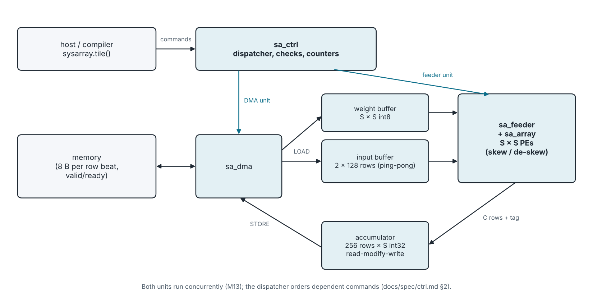
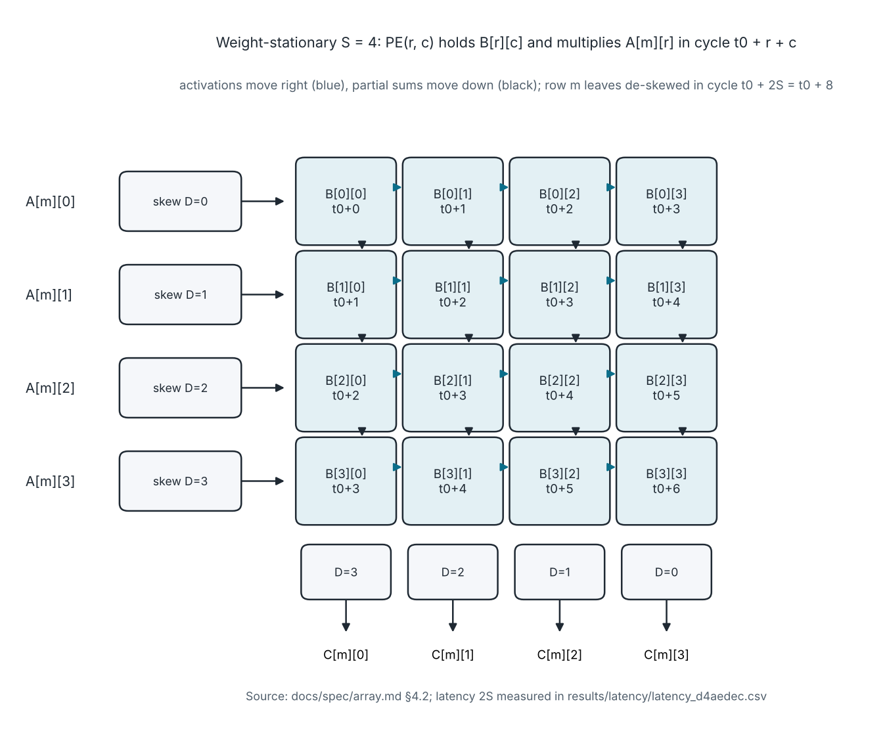

# SysArray architecture

One section per block, from the PE up to the controller. Each section gives
the interface, the behaviour and one cycle table; the full contracts (every
port, reset, test list) are in `docs/spec/`. "Cycle t" is the interval after
rising edge t; numbers are for the RTL on `main` and are checked by the tests
named in each spec.

`sa_top` = `sa_ctrl` + `sa_core`; `sa_core` = `sa_dma` + weight buffer + input
buffer + `sa_feeder` + `sa_array` + `sa_acc`. S = 8 for every reported result.

## 1. Processing element `sa_pe` (`docs/spec/pe.md`)

Interface: `a_in`/`a_valid_in` from the left, `a_out`/`a_valid_out` to the
right (one register), `psum_in` from above, `psum_out` below, and the weight
shift chain `w_in`/`w_out` with a broadcast `w_load`.

Behaviour: a two-stage MAC (M7b). Stage 1 registers
`p = a_valid ? a · w : 0` (an invalid activation adds zero, D-011); stage 2
adds `psum_in + p` with int32 wrap (D-004a). The weight register doubles as
the shift-chain stage (D-012). With `SA_ECP5_DSP` the stage-1 register is the
MULT18X18D output register (D-027).

Partial sums down a 3-PE column (row r gets its activation in cycle r):

| Cycle | PE0 | PE1 | PE2 |
| --- | --- | --- | --- |
| 0 | a0 in | – | – |
| 1 | p = a0·W0; add 0 + p | a1 in | – |
| 2 | `psum_out` = a0·W0 | p = a1·W1; add | a2 in |
| 3 | – | `psum_out` = a0·W0 + a1·W1 | p = a2·W2; add |
| 4 | – | – | `psum_out` = a0·W0 + a1·W1 + a2·W2 |

## 2. Array `sa_array` = `sa_grid` + skew (`docs/spec/array.md`)

Interface: `w_load`/`w_row` (one weight row per cycle, S cycles per tile),
`a_valid`/`a_row` (one row of A per cycle, all S elements together),
`c_valid`/`c_row` (S int32 results per row).

Behaviour: input skew delays element r by r cycles (`sa_reg` D = r), output
de-skew delays column c by S − 1 − c, so A[m][r] meets B[r][c] in PE(r, c) in
cycle t0 + r + c and the whole row of C appears together in cycle t0 + 2S.
Weights reload only after the array has drained (D-015).

| Event (one tile, M rows, first `w_load` in cycle 0) | Cycle |
| --- | --- |
| weights loaded (S cycles) | 0 … S − 1 |
| row m enters | S + m |
| row m leaves (`c_valid`) | S + m + 2S |
| tile time (first `w_load` to the cycle after the last output) | M + 3S |

Measured: latency 2S and T_tile = M + 3S in 10/10 rows
(`results/latency/latency_d4aedec.csv`).

## 3. Buffers and feeder `sa_feeder` (`docs/spec/buffers.md`)

Buffers (D-016): weight buffer S × S int8 (one tile), input buffer 256 rows ×
S int8, both 1R1W with a 1-cycle registered read, read-first (D-017).

`sa_feeder` runs one array command at a time: LOAD_W reads weight rows S−1 … 0
into the array; STREAM reads input rows `base` … `base + M − 1`. An output
register sits between buffer and array (M7b), so a row reaches the array two
cycles after its read. LOAD_W with `rows` = r < S zero-fills the missing rows
(D-029).

| Command (`start` in cycle t) | Array input | `done` | Next `start` accepted |
| --- | --- | --- | --- |
| LOAD_W | `w_load` in t+3 … t+S+2 | t+S+2 | t+S+3 |
| STREAM of M rows | `a_valid` in t+3 … t+M+2 | t+M+2 | t+M+3 |

## 4. DMA `sa_dma` (`docs/spec/dma.md`)

Interface: a descriptor (`dir`, `target`, `mem_addr`, `mem_stride`, `rows`,
`buf_addr`) with `start`/`busy`/`done`; memory read and write channels with
valid/ready (one 8-byte row beat per cycle); write ports into the buffers and
a read port on the accumulator.

Behaviour: LOAD issues one read request per cycle and writes each response
into the next buffer row; STORE reads one accumulator row (S int32 = 4 beats
at S = 8) and writes it as four 8-byte beats.

| LOAD of R rows, read latency L (`start` in t) | Cycle |
| --- | --- |
| request i | t + 1 + i |
| response i written to buffer row `buf_addr` + i | t + 1 + i + L |
| `done` | t + R + L |

| STORE of R rows (`start` in t) | Cycle |
| --- | --- |
| source read of row 0 | t + 1 |
| beats 0 … 3 of row i | t + 2 + 4i … t + 5 + 4i |
| `done` | t + 4R + 1 |

## 5. Accumulator `sa_acc` (`docs/spec/acc.md`)

Interface: `c_valid`/`c_row` from the array with a per-row tag
(`c_mode`, `c_addr`; M13), and the STORE read port.

Behaviour: 256 rows × S int32, OVERWRITE or ACCUMULATE per row. The tag
(mode, base + j) is formed when the row enters the array and travels with it
through a 2S-deep delay line, so rows of different COMPUTEs may follow each
other without a gap (D-024 → D-030). Three-stage read-modify-write (M11b):

| Cycle | OVERWRITE | ACCUMULATE |
| --- | --- | --- |
| t (`c_valid`) | capture row, address, mode | also read row p |
| t + 1 | – | register the BRAM read data |
| t + 2 | write `c_row` to p | write old[p] + `c_row` (int32 wrap) |

Same-row rule: an ACCUMULATE row arrives ≥ 3 cycles after the previous write
to that row; consecutive COMPUTEs are ≥ 4 cycles apart, so it always holds.

## 6. Controller `sa_ctrl` (`docs/spec/ctrl.md`)

Interface: one 93-bit command per valid/ready transfer (LOAD_W, LOAD_A,
COMPUTE, STORE; `rtl/ctrl/sa_pkg.sv`, mirrored by
`compiler/sysarray/commands.py`), sticky error code, busy, and 48-bit
performance counters.

Behaviour: an in-order dispatcher with two units running concurrently, the
DMA (LOAD_A, STORE, LOAD_W's transfer) and the feeder (COMPUTE, LOAD_W's array
load). CHECK evaluates the five error codes (unknown op, rows, range, no
weights, reads of never-written rows); DECIDE acts on the registered result
(M11c, D-028). A command then waits only for its unit and for real
dependencies: RAW/WAR on input-buffer rows, STORE vs COMPUTE (one accumulator
read port), LOAD_W vs weights still streaming, the array reload rule and the
last accumulator write before a STORE.

| Command accepted in cycle t (units free) | Unit `start` | Unit `done` | `cmd_ready` again |
| --- | --- | --- | --- |
| LOAD_A, R rows | DMA: t + 3 | t + 3 + R + L | t + 4 |
| LOAD_W | DMA: t + 3; feeder: d + 1 (d = DMA done) | d + S + 3 | d + 2 |
| COMPUTE, R rows | feeder: t + 3 | t + R + 5 | t + 4 |
| STORE, R rows | DMA: t + 3 | t + 4R + 4 | t + 4 |

Double buffering is a compiler convention on top of this (D-030):
`sysarray.tile()` alternates LOAD_As between input rows 0–127 and 128–255 and
moves each LOAD_A ahead of the LOAD_W/STORE before it, so the next chunk's
transfer overlaps the current COMPUTE. `sysarray.predict()` replays this
dispatcher exactly (measured = predicted in 16/16 runs,
`results/perf/be6f466.csv`).

## 7. Software (`compiler/sysarray/`)

- `golden.py`: NumPy int8 × int8 → int32 reference (the tests' oracle).
- `tiler.py`: any M, N, K → command program (orders A and B, host padding
  D-025, partial weight tiles D-029, ping-pong halves).
- `funcsim.py`: the command semantics in Python (functional model for the
  random-program tests).
- `predict.py`: cycle-exact replay of the controller for a non-stalling
  memory.
