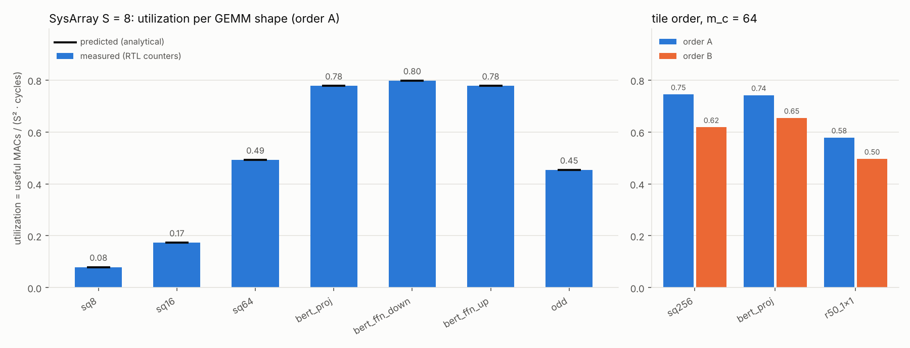
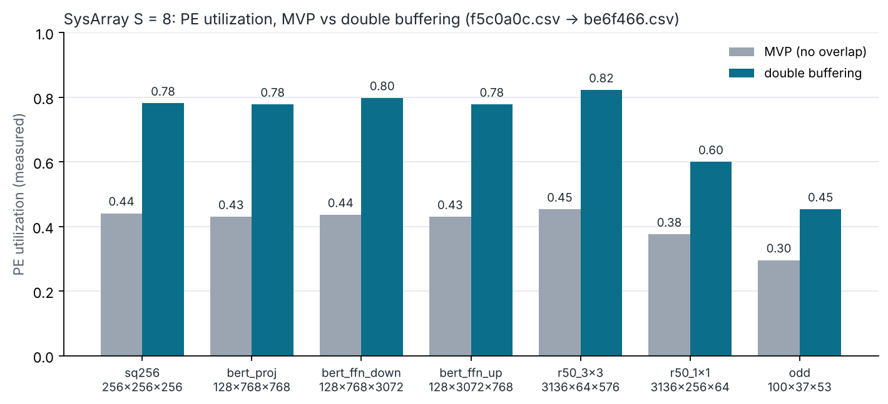
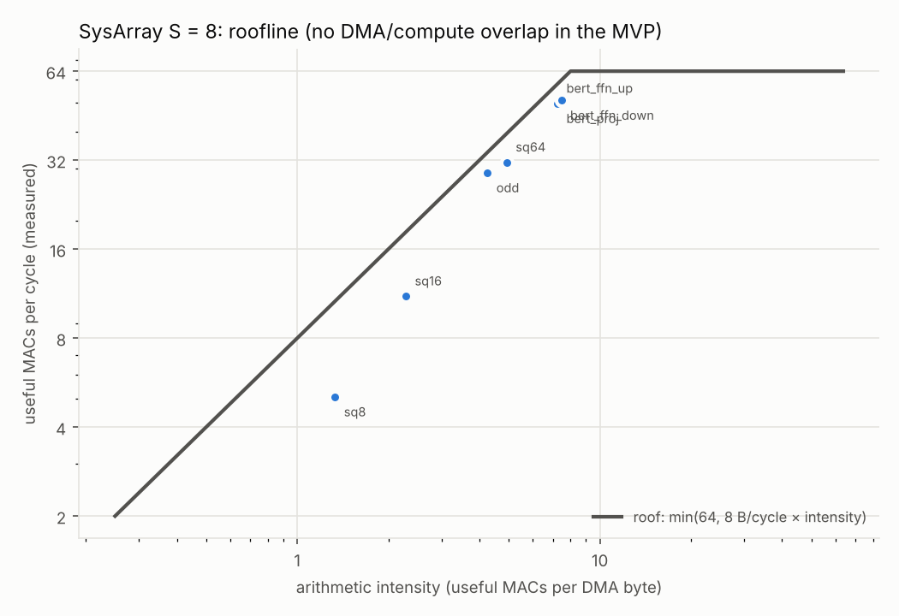

# Performance: cycles, utilization, tile order

How fast SysArray runs real GEMM shapes, why, and what limits it. Every number
comes from a file in `results/` (cited next to it); predictions are labelled
"predicted (analytical)". Back to the [README](../README.md).

## Setup

All rows: `results/perf/be6f466.csv` (`make perf`, S = 8, double buffering
with the two-cycle CHECK; memory always ready with read latency 3 and one
8-byte row per cycle). Every run also checks C against NumPy. The last
column is the v0.1 MVP (no overlap, `results/perf/f5c0a0c.csv`).

**Utilization** = useful MACs / (S² × cycles): the fraction of the 64 PEs
doing useful work in an average cycle. Padded MACs count as issued, not
useful (D-025).

## Predicted, then measured

The predictor (`compiler/sysarray/predict.py`) replays the controller's timing
from the command stream alone, before the RTL runs. The measured cycle
counters equal its prediction in **16 / 16 runs** (`results/perf/be6f466.csv`),
and the array's own latency model matches in 10 / 10
(`results/latency/latency_d4aedec.csv`: a row of C leaves 2S = 16 cycles after
its row of A enters; one tile takes M + 3S cycles).

The predictor is exact only for a memory that never stalls (D-025); with a
real DRAM it would need a bandwidth term and become a roofline-style bound.

## Results per shape



| Shape | M × N × K | cycles (measured) | predicted (analytical) | utilization | MVP utilization |
| --- | --- | --- | --- | --- | --- |
| sq8 | 8 × 8 × 8 | 101 | 101 | 0.079 | 0.078 |
| sq16 | 16 × 16 × 16 | 369 | 369 | 0.173 | 0.146 |
| sq256 | 256 × 256 × 256 | 335,463 | 335,463 | 0.781 | 0.441 |
| bert_proj | 128 × 768 × 768 | 1,516,071 | 1,516,071 | 0.778 | 0.430 |
| bert_ffn_down | 128 × 768 × 3072 | 5,912,103 | 5,912,103 | 0.798 | 0.436 |
| bert_ffn_up | 128 × 3072 × 768 | 6,063,879 | 6,063,879 | 0.778 | 0.430 |
| r50_3x3 | 3136 × 64 × 576 | 2,195,807 | 2,195,807 | 0.823 | 0.453 |
| r50_1x1 | 3136 × 256 × 64 | 1,338,343 | 1,338,343 | 0.600 | 0.376 |
| odd | 100 × 37 × 53 | 6,752 | 6,752 | 0.454 | 0.296 |

Small shapes (sq8, sq16) are dominated by fill/drain and command decode: an
8 × 8 × 8 GEMM is one tile, and the 2S-cycle pipeline latency is paid once.

## What double buffering changed



The controller now dispatches to the DMA and the feeder concurrently
(`docs/spec/ctrl.md` §2), the compiler alternates LOAD_As between the two
input-buffer halves, and the accumulator tags each row, so the next chunk's
LOAD_A runs while the current chunk streams. A k-tile of 256 rows now costs
≈ 2 × 131 + 2S + 7 cycles instead of ≈ 2M + 40 (predicted, analytical;
`docs/spec/ctrl.md` §3). Measured, the BERT, ResNet-50 3×3 and sq256 GEMMs
take 1.77× (sq256) to 1.83× (bert_ffn_down) fewer cycles, and r50_1x1 and odd
about 1.5–1.6× fewer, each at its default chunk size (`results/perf/f5c0a0c.csv`
vs `results/perf/be6f466.csv`).

What is left: the weight reload (≈ 3S cycles per k-tile, no shadow weights,
D-030), the STORE (4 cycles per row, exclusive with COMPUTE: one accumulator
read port) and, for small shapes, fill/drain and command decode. r50_1x1
(K = 64: only 8 k-tiles per output strip) is the most STORE-bound shape
(0.600). Next step: shadow weight registers and STORE overlap, predicted
(analytical) sq256 utilization ≈ 0.88 (D-030).

## Roofline



The roof is min(64 MACs/cycle, 8 B/cycle × arithmetic intensity): S² = 64 PEs
give the compute peak, and the DMA moves one 8-byte row per cycle. The ridge
is at 8 useful MACs per DMA byte. The BERT shapes sit near the ridge, so they
are close to both limits at once; the small shapes sit well below the roof
because of fixed per-tile overhead (fill/drain, command decode), not only
bandwidth.

## Tile order (the compiler's choice)

The tiler supports two loop orders. Order A keeps a weight tile in the array
and streams all of its M rows through it (weight reuse); order B walks M
chunks on the outside and reloads every weight tile once per chunk. At
m_c = 64, order A still wins:

| Shape (m_c = 64) | order A util. | order B util. | A weight bytes | B weight bytes |
| --- | --- | --- | --- | --- |
| sq256 | 0.745 | 0.618 | 65,536 | 262,144 |
| bert_proj | 0.742 | 0.654 | 589,824 | 1,179,648 |
| r50_1x1 | 0.579 | 0.497 | 212,992 | 802,816 |

Source: `results/perf/be6f466.csv` (rows with m_c = 64). Order B moves 2–4×
more weight bytes for the same GEMM, and each extra weight load is ≈ 3S
cycles in which the array does not compute.

## Cross-check: SCALE-Sim v3

Same 8×8 WS array and buffer sizes (`results/scalesim/`, note in
`results/scalesim/COMPARISON.md`): for sq8 / sq16 / sq64 / odd SCALE-Sim
reports 43 / 240 / 14,078 / 4,570 cycles vs the SysArray MVP's 103 / 438 /
12,696 / 10,355 (`results/perf/f5c0a0c.csv`). SCALE-Sim assumes prefetching
(double-buffered) SRAMs, so the gap on the small shapes is SysArray's
serialized DMA and command overhead. sq256
(`results/scalesim/sq256/COMPUTE_REPORT.csv`): 2,963,801 cycles, 2,678,515 of
them stalls from the minimum-size SRAM config, vs the MVP's 594,528. The
other large shapes have no SCALE-Sim result (they exceeded a 3-hour limit;
stated in the note).

## Reproduce

```bash
make perf                                                    # ~30 min, writes results/perf/<sha>.csv
python3 scripts/measure/plot_perf.py results/perf/<sha>.csv  # utilization + roofline plots
python3 scripts/report/readme_figures.py                     # MVP vs double-buffering chart
make compile M=128 N=768 K=768                               # one GEMM's commands + predicted cycles
```
