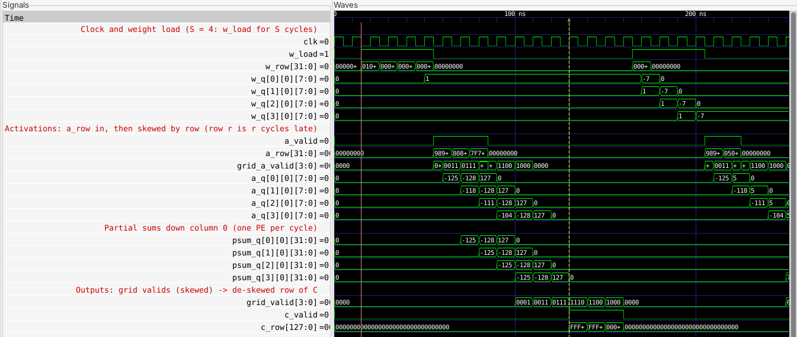
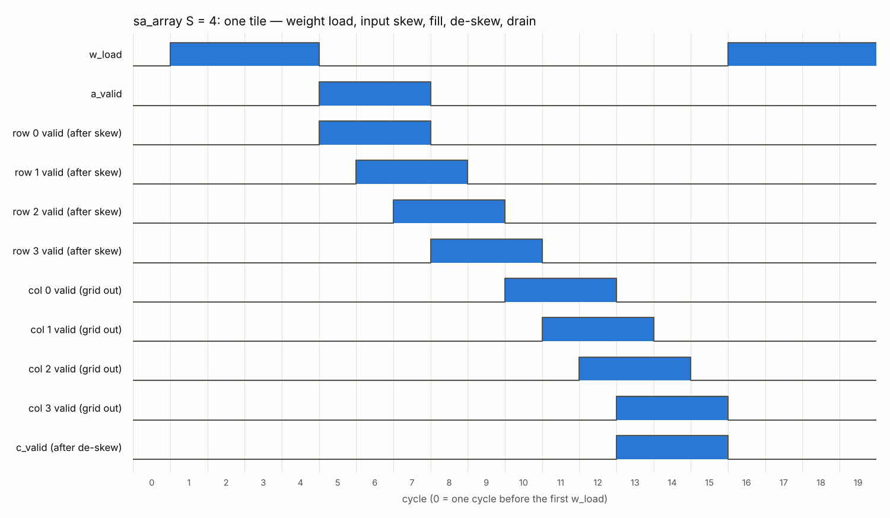

# Waveforms: see the array work

Three ways to watch the hardware work, from easiest to most detailed. All of
them start from a real simulation of the RTL; nothing is drawn by hand.
Back to the [README](../../README.md).

Waveform pictures of one full S = 4 tile (weight load, compute, drain) live in
`docs/img/`: `waves_tile_s4.png` (GTKWave, `make waves-png`), `tile_s4.png`
(signal traces, `scripts/waves/plot_tile.py`) and `tile_s4.gif` (animation,
`make animate`). Raw VCD/FST files are not committed; `make demo-waves`
regenerates the VCD.

**1. The animation (no tools needed).** The GIF at the top of the README.
Regenerate it from a fresh simulation:

```bash
make animate      # simulate one S = 4 tile, then write docs/img/tile_s4.gif (seconds once the simulator is built)
```

How to read a frame: each box is one processing element (PE). `w` is the
weight it holds (stationary), `a` the activation passing through it (moves
right, highlighted while valid), `Σ` the partial sum it passes down (one cycle
after `a`, because multiply and add are two pipeline stages). On the left, the
value entering each row after the skew (row r is r cycles late); at the
bottom, the finished row of C after the de-skew, 2S = 8 cycles after its row
of A went in.

**2. The waveform in GTKWave (one tile, saved layout).** Needs
`sudo apt install gtkwave`.

```bash
make demo-waves   # simulate one S = 4 tile with waves on, open it in GTKWave
```

This writes `build/demo/tile_s4.vcd` and opens it with the layout
`docs/demo/tile_s4.gtkw`, four signal groups top to bottom
(screenshot of that view; regenerate with `make waves-png`):




| Group | Signals | What to look for |
| --- | --- | --- |
| Weight load | `w_load`, `w_row`, weights of column 0 | one row of B shifts in per cycle while `w_load` is high |
| Activations | `a_row`, `grid_a_valid`, `a_q` of column 0 | each row of the array sees A one cycle after the row above (the skew) |
| Partial sums | `psum_q` down column 0 | the sum grows by one product per PE, one PE per cycle |
| Outputs | `grid_valid`, `c_valid`, `c_row` | the de-skewed row of C leaves all at once |

Markers sit at the first `w_load` (15 ns) and the first `c_valid` (130 ns).
In this first tile the weights are the identity (`w_q[0][0]` = 1, the rest of
column 0 is 0), so column 0 of C equals column 0 of A: the values −125, −128,
127 enter `a_q[0][0]` and pass unchanged down `psum_q[r][0]`, one PE per cycle.
The columns leave the grid skewed (`grid_valid` 0001 → 0011 → 0111 → 1110 →
1100 → 1000 for the three rows of A), and after the de-skew `c_valid` is high
for three cycles, one whole row of C per cycle.
Without a desktop (or to open it again later):

```bash
make demo-waves && gtkwave build/demo/tile_s4.vcd docs/demo/tile_s4.gtkw
```

**3. Waveforms of any test.** Every cocotb testbench dumps a VCD when
`SYSARRAY_WAVES=1`:

```bash
SYSARRAY_WAVES=1 make test-rtl        # all blocks (a few minutes)
```
```bash
SYSARRAY_WAVES=1 SYSARRAY_SEED=5 python3 -m pytest -q "tb/array/test_array.py::test_sa_array[4-False]"   # one test
```
```bash
find tb -name dump.vcd                # where the waveforms are (one per build directory)
```

Open one with `gtkwave <path>/dump.vcd`. GTKWave basics: expand the hierarchy
in the top-left pane (SST), select signals and click **Append** (or drag them
into the Signals pane); **Zoom Fit** (Ctrl+Alt+F) shows the whole run; right-
click a bus → **Data Format** → **Signed Decimal** to read int8/int32 values;
click in the wave area to place the cursor and read every value at that time;
**File → Write Save File** keeps your layout. For a text view instead,
`python3 scripts/waves/vcd_cycle_table.py <vcd> <n>` prints the cycle table of
the n-th isolated row from an `sa_array` VCD.

## The same tile, as signal traces



`scripts/waves/plot_tile.py` draws this from the simulation's VCD. For the
dataflow picture with the cycle at which each PE multiplies each row, see
[ARCHITECTURE.md](../ARCHITECTURE.md).
